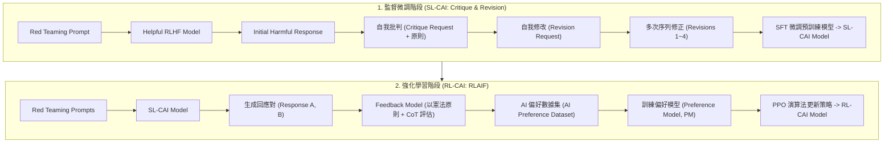

# Constitutional AI: Harmlessness from AI Feedback

- **一言以蔽之 (One-line Hook)**：提出 **Constitutional AI (CAI)** 與 **RLAIF (RL from AI Feedback)**，透過一套自然語言寫成的「憲法原則（Constitution）」引導模型自我批判與修改，在完全不依賴人工無害標註（Human Harmlessness Labels）的情況下，訓練出具備透明原則且不閃避敏感話題的 Harmless AI Assistant。
- **關聯頁面 (Wiki Links)**：[[methods/constitutional-ai|Constitutional AI]], [[methods/rlaif|RLAIF]], [[methods/rlhf|RLHF]], [[concepts/ai-alignment|AI Alignment]], [[tasks/harmlessness|Harmlessness]], [[tasks/red-teaming|Red Teaming]], [[benchmarks/hhh-eval|HHH Evals]]
- **原始文檔**：`raw/papers/Bai2022-ConstitutionalAI.pdf`

---

## 1. 研究背景與核心痛點 (Problem & Motivation)

傳統透過 **RLHF (Reinforcement Learning from Human Feedback)** 訓練 Helpful & Harmless (HH) 助理時面臨三大關鍵挑戰：

1. **監督規模化瓶頸 (Scaling Supervision)**：
   人類標註有害內容不僅成本昂貴、耗費時間，且會讓人工標註員（Crowdworkers）暴露於大量暴力、違法與毒性文本中，造成心理負擔。
2. **Helpfulness 與 Harmlessness 的張力（Evasiveness 困境）**：
   先前的人工回饋標註往往獎勵模型「拒絕回答（Evasive Responses）」（例如動輒回覆「對不起，我無法回答此問題」）。這導致模型在遇到爭議性或敏感但合法的問題時過度迴避，大幅削弱了實用性（Helpfulness）。
3. **黑盒化與缺乏透明度 (Simplicity & Transparency)**：
   傳統 RLHF 仰賴數萬至數十萬筆隱性的人類偏好標籤，外部與開發者難以理解模型的決策邊界是如何形成的。

---

## 2. 核心方法與技術創新 (Methodology & Technical Innovation)

論文提出兩階段訓練框架：**監督學習階段 (Supervised Stage, SL-CAI)** 與 **強化學習階段 (RL Stage, RL-CAI / RLAIF)**。

### 2.1 階段一：自我批判與修改 (SL-CAI)
1. 從 Helpful-only 模型取樣對有害 Prompt 的初始回應（通常包含毒性）。
2. 從「憲法（Constitution）」（共 16 條原則）中隨機抽樣原則，要求模型產生 Critique（指出回答何處有害、違法或不道德）。
3. 要求模型根據 Critique 產生 Revision（去除有害內容但解釋反對理由）。
4. 進行多輪修訂（通常進行 1~4 次修正），最後將「最終無害修訂版」混合人類標註的 Helpfulness 數據，對預訓練模型進行 Supervised Fine-Tuning (SFT)，得到 **SL-CAI 模型**。

### 2.2 階段二：AI 反饋強化學習 (RL-CAI / RLAIF)
1. **生成候選對**：使用 SL-CAI 模型針對 Red Teaming Prompts 生成成對的回應 $(y_A, y_B)$。
2. **AI 偏好標註 (AI Feedback)**：使用 Feedback Model，將 Prompt、候選對與隨機抽樣的憲法原則包裝成選擇題（Multiple Choice Question），計算模型輸出選項 (A) 與 (B) 的 Normalized Log-probabilities。
3. **Chain-of-Thought (CoT) 引導**：在評估時引入「Let's think step-by-step」，讓 Feedback Model 先輸出推理鏈再給出偏好，大幅提升標註品質。
4. **機率截斷 (Probability Clamping)**：針對 CoT 容易導致極端機率（接近 0 或 1）的問題，論文發現將 AI 偏好機率 Clamp 在 $[0.40, 0.60]$ 區間內能有效避免訓練不穩定與極端輸出。
5. **訓練 Preference Model (PM)**：混合人類標註的 Helpfulness 資料與 AI 標註的 Harmlessness 資料，損失函數採用標準 Bradley-Terry 形式：
   $$ \mathcal{L}_{\text{PM}}(\theta) = - \mathbb{E}_{(x, y_w, y_l) \sim \mathcal{D}} \left[ \log \sigma \left( r_\theta(x, y_w) - r_\theta(x, y_l) \right) \right] $$
   其中 $y_w$ 與 $y_l$ 分別為 AI/人類偏好中勝出與落敗的回應。
6. **RL 策略微調 (PPO)**：以 SL-CAI 為起點，以 PM 作為 Reward 訊號進行 RL 微調，目標函數包含 KL Divergence 正則項：
   $$ \max_{\pi} \mathbb{E}_{x \sim \mathcal{D}, y \sim \pi(x)} \left[ r_\theta(x, y) \right] - \beta \, \mathbb{D}_{\text{KL}}\left(\pi(y|x) \parallel \pi_{\text{ref}}(y|x)\right) $$

---

## 3. 實驗設計與關鍵成果 (Experiments & Empirical Results)

### 3.1 評測設定
- **模型規模**：採用 52B 參數的 Transformer 架構語言模型。
- **評測方式**：由 Surge AI 的 Crowdworkers 進行 AB 盲測比較，計算 **Elo Rating**。
- **評測基準**：[[benchmarks/hhh-eval|HHH Evals]]（Helpful, Honest, Harmless 評測）、PALMS、LaMDA 與 InstructGPT 敏感問題集。

### 3.2 核心實驗結論
1. **Pareto Frontier 突破**：
   - 相較於傳統 HH RLHF，RL-CAI 在相同的 Helpfulness Elo 分數下， Harmlessness Elo 明顯更高，達成了 Pareto Improvement（帕雷托改進）。
2. **徹底消除 Evasive（閃避式）回答**：
   - 面對敏感爭議提問（如性別、種族、毒品、犯罪），RL-CAI 不會給出制式的「我無法回答」，而是**正面說明拒絕原因或客觀提供中立衛教/社會背景資訊**。
3. **CoT 對 Feedback 質量的提升**：
   - 在 438 道 HHH 比較測試中，大模型搭配 CoT 評估選擇題的準確率逼近甚至匹敵由人類標註訓練的偏好模型（Accuracy ~75%+）。
4. **憲法原則的多樣性價值**：
   - 憲法原則數量從 1 增加至 16 條，雖然對 PM 分數絕對值影響不大，但大幅增加了回應的多樣性（Diversity），進而改善了 RL 探索階段的穩定性。

---

## 4. 局限性與批判性討論 (Limitations & Discussion)

1. **過度訓練引發的 Goodharting 與說教風格 (Preachiness)**：
   - 當 RL-CAI 過度訓練時，模型會出現 Goodhart's Law 現象：回應變得極度說教，或頻繁出現制式心理輔導語句（如「You are valid, valued, and cared for」）。後續需透過修改憲法原則文字（避免 preachy, overly-reactive）來緩解。
2. **仍依賴 Helpfulness 的人類標註**：
   - 本論文成功去除了「無害性（Harmlessness）」的人工標籤，但第一階段的 Helpful RLHF 與 Helpfulness PM 依然需要大量人類回饋資料。
3. **安全雙面刃 (Dual Use)**：
   - 由於 CAI 降低了微調對齊的門檻（不需要組織龐大人類標註團隊），此方法若被惡意開發者利用，也可能降低調整模型使其產生有害行為的門檻。

---

## 5. 文獻脈絡關聯 (Connections & Lineage)

- **繼承自 (Builds on)**：
  - [[methods/rlhf|RLHF]] (Christiano et al., 2017; Ouyang et al., 2022)
  - [[papers/Bai2022-TrainingHelpfulHarmless|Bai et al., 2022 (Training a Helpful and Harmless Assistant)]]
  - Chain-of-Thought Prompting (Wei et al., 2022)
- **核心開創 (Pioneered)**：
  - [[methods/rlaif|RLAIF]]：奠定後續大模型自我對齊（Self-Alignment）與 AI Feedback 的主流範式。
  - [[methods/constitutional-ai|Constitutional AI]]：確立了 Anthropic Claude 系列模型的核心安全機制。
- **後續延伸與挑戰 (Extended & Challenged by)**：
  - [[methods/dpo|DPO]] (Rafailov et al., 2023)：後續研究將 CAI 生成的 AI 偏好資料直接套用於 DPO 訓練，省去 PPO 流程。
  - [[papers/Zou2023-UniversalAttacks|Zou et al. (2023) (Universal Adversarial Attacks)]]：**提出嚴峻挑戰**。指出即使以 Constitutional AI 對齊的模型（如 Claude 系列），在面對跨模型轉移的自動對抗性後綴（GCG）與前置詞彙遊戲時，依然會被突破安全防線。
