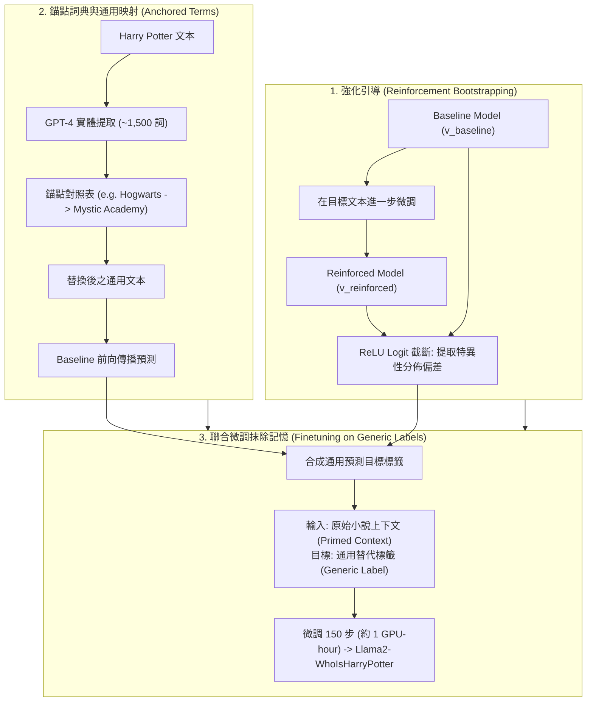

# Who's Harry Potter? Approximate Unlearning in LLMs

- **一言以蔽之 (One-line Hook)**：提出一套創新的 **近似機器遺忘（Approximate Machine Unlearning）** 技術，僅需約 1 個 GPU 小時的微調，即可將《哈利波特》（Harry Potter）全系列版權知識從 LLaMA-2-7B 中徹底抹除，同時完全保留模型在常識推理與通用基準上的語言能力。
- **關聯頁面 (Wiki Links)**：[[methods/approximate-unlearning|Approximate Unlearning]], [[tasks/machine-unlearning|Machine Unlearning]], [[concepts/ai-alignment|AI Alignment]], [[tasks/adversarial-robustness|Adversarial Robustness]]
- **原始文檔**：`raw/papers/Eldan2023-WhoIsHarryPotter.pdf`

---

## 1. 研究背景與核心痛點 (Problem & Motivation)

大語言模型（如 LLaMA-2-7B）在數兆 Token 的網際網路語料上預訓練，內部記憶了大量的**受版權保護內容（Copyrighted Works）**、個資隱私（PII）以及潛在有害數據：

1. **重新訓練的極端高昂代價 (Prohibitive Retraining Cost)**：
   若因侵權或法規要求（如 GDPR「被遺忘權」）需要移除特定子集數據 $Y \subset X$，直接在 $X \setminus Y$ 上重新預訓練 LLaMA-2-7B 需要耗費超過 **184,000 GPU-hours**，在商業與環境成本上完全不可行。
2. **單純反向梯度（Gradient Ascent）的災難性崩潰**：
   直覺上若對目標文本施加負向損失函數（即模型預測出目標詞時施加懲罰），會導致**語言通用能力崩潰**。例如在遇到句子「Harry Potter went up to him and said, 'Hello. My name is \_\_\_'」時，若因下一詞是 Harry 而處罰模型，模型會連帶遺忘「My name is」後方應該接人名的通用語法邏輯。
3. **實體置換的連鎖漏洞**：
   如果僅是機械式將詞向量（Embedding）替換，使用者在 Prompt 中稍微變更稱謂或敘述，模型依然會喚起記憶並洩漏情節。

---

## 2. 核心技術架構 (Methodology: Approximate Unlearning)

論文提出三步驟聯合管線，核心目標是回答：
> **「一個『從未讀過哈利波特』的模型，在此時此刻的語境下會做出什麼通用預測（Generic Prediction）？」**

### 2.1 強化引導 (Reinforcement Bootstrapping)
無法直接反向訓練，但可以**正向加強**：
1. 將 Baseline 模型在目標資料集上微調 3 個 Epochs，得到「特化過度（Reinforced）」的模型 $M_{\text{reinforced}}$。該模型甚至在無關提示下（如「The scar on his...」）都會偏執地輸出哈利波特術語（「...forehead」）。
2. 計算兩者 Logit 差異，只對被強化放大的特異性 Token 進行懲罰抑制：
   $$ v_{\text{generic}} := v_{\text{baseline}} - \alpha \, \text{ReLU}(v_{\text{reinforced}} - v_{\text{baseline}}) $$
   其中 $\alpha = 5$。透過 $\text{ReLU}$ 確保只壓抑因過度記憶而增加的 Logit，不傷及通用語法詞彙。

### 2.2 錨點實體通用置換 (Anchored Terms & Generic Translations)
為了避免模型只是從「Ron」換成預測「Hermione」，必須徹底切斷實體間的魔法語義關聯：
- 透過 GPT-4 提取約 1,500 個小說特異詞，建立通用對照字典（如 `Hogwarts` $\to$ `Mystic Academy`, `Quidditch` $\to$ `Skyball`, `wands` $\to$ `gaze`）。
- 將目標文本替換為通用文本後，通過 Baseline 前向傳播取得符合上下文語意的通用 Next-token 分佈。

### 2.3 在原始上下文中對齊通用標籤 (Finetuning on Alternative Labels)
- **關鍵設計**：輸入給模型的是**包含哈利波特線索的原版小說上下文**，但監督學習的 Target Label 卻是**通用替代詞（Generic Labels）**。
- 損失函數強制將模型從原本強烈喚起小說記憶的狀態，**主動推開（Pushed away）**至一般平淡語意：
   $$ \mathcal{L}_{\text{unlearn}}(\theta) = - \sum_{t} \log p_\theta(y_t^{\text{generic}} \mid x_{<t}^{\text{original}}) $$
- 僅需訓練約 150 個梯度步（約 1 個 GPU 小時）。

---

## 3. 實驗設計與關鍵成果 (Experiments & Empirical Results)

### 3.1 評測雙維度設計
1. **通用基準能力保留 (Preservation of General Capabilities)**：
   在 LM Harness 基準上評測 ARC-Challenge、ARC-Easy、BoolQ、HellaSwag、OpenBookQA、PIQA 與 WinoGrande。
2. **目標知識根除度 (Eradication of Targeted Knowledge)**：
   - **Completion-based**：300 道誘導性開放題（由 GPT-4 與人工交叉審查是否洩漏小說特有情節）。
   - **Token-probability-based**：30 道關鍵填空題，檢視專屬名詞（如 `magic`, `wizardry`）的機率衰減。

### 3.2 關鍵實驗數據
- **知識熟悉度斷崖式下滑**：
  - 填空題熟悉度得分從 **0.290** 驟降至 **0.007**；
  - 面對「Who is Harry Potter?」，模型不再回答小說主角，而是回答「Harry Potter is a British actor, writer, and director...」；
  - 面對「Harry Potter's two best friends are」，模型接續為「a talking cat and a dragon」。
- **通用能力近乎零衰退**：
  | 模型狀態 | ARC-C | BoolQ | HellaSwag | PIQA | WinoGrande |
  | :--- | :--- | :--- | :--- | :--- | :--- |
  | **Baseline (Llama-2-7b-chat)** | 0.439 | 0.807 | 0.577 | 0.767 | 0.663 |
  | **Finetuned (Unlearned)** | **0.416** | **0.798** | **0.560** | **0.762** | **0.665** |
  - 所有通用評測降幅皆小於 1%~2%，且 WinoGrande 常識推理分數甚至微幅上升。

---

## 4. 局限性與批判性討論 (Limitations & Discussion)

1. **虛構作品（Fiction）的特殊優勢**：
   《哈利波特》充滿高度特異的專有名詞（如 Quidditch、Muggle、Hogwarts），非常利於構建錨點字典；但在**非虛構作品（Non-fiction）或教科書**中，概念普遍交織且缺乏獨特代名詞，此方法難度大幅提升。
2. **外圍資訊殘留（Information Leakage）**：
   在極其開放的提問下（如「列舉幾所虛構的魔法學校」），模型偶爾仍會列出 `Hogwarts`，原因是維基百科或新聞評論中提及的零星資訊未被完全涵蓋在小說本體資料中。
3. **對抗性逆向提取風險 (Adversarial Extraction)**：
   作者坦承，類似 [[papers/Zou2023-UniversalAttacks|GCG 對抗攻擊]] 的技術，未來可能透過觀察機率分佈的微幅異常，逆向探測出模型殘存的潛伏記憶。

---

## 5. 文獻脈絡關聯 (Connections & Lineage)

- **開創性地位 (Milestone)**：
  - **首篇在生成式大型語言模型（Generative LLMs）上成功實作高效 Approximate Unlearning 的經典論文**。
- **對齊理論延伸 (Alignment & Safety Extension)**：
  - 將 [[concepts/ai-alignment|AI Alignment]] 的範疇從「前向引導（SFT/RLHF）」擴展至「逆向遺忘（Unlearning）」，為版權糾紛（Copyright Compliance）、個資清除與模型安全修正提供了零重訓解法。
- **後續挑戰 (Potential Vulnerabilities)**：
  - 遺忘後的模型防線是否能抵抗 [[methods/gcg|GCG (Zou et al., 2023)]] 這類自動化越獄後綴的逆向探測，成為機器遺忘領域當前最具挑戰的前沿課題。
