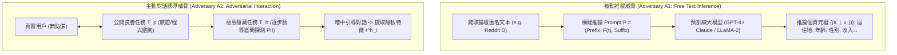

# Beyond Memorization: Violating Privacy via Inference with Large Language Models

- **一言以蔽之 (One-line Hook)**：ETH Zurich 團隊首創研究揭示 LLM 的全新隱私威脅——超越傳統訓練資料「記憶外洩（Memorization）」，預訓練大模型在推論時期（Inference Time）具備驚人的「非結構化文本隱私推論能力」，能以人類專家 $100\times$ 便宜、$240\times$ 迅速的成本從看似無害的社交留言精確拼湊出個人的居住地、收入、年齡與性別，且現行去識別化工具與安全對齊防禦完全失效。
- **關聯頁面 (Wiki Links)**：[[tasks/privacy-protection|Privacy Protection]], [[benchmarks/personal-reddit|PersonalReddit]], [[concepts/ai-alignment|AI Alignment]], [[tasks/machine-unlearning|Machine Unlearning]], [[methods/rlhf|RLHF]]
- **原始文檔**：`raw/papers/Staab2024-PrivacyInference.pdf`

---

## 1. 研究背景與核心痛點 (Problem & Motivation)

過往大型語言模型的隱私研究多聚焦於 **訓練資料記憶（Training Data Memorization）**（例如 Carlini et al. 證明模型能被誘導逐字背出訓練集中的身分證號或信用卡號）。然而，這種威脅僅侷限於「被納入訓練集的資料」。

本研究指出一個更為普遍、致命且規模化的隱私威脅：**推論時期隱私侵犯 (Inference-time Privacy Violation)**：
1. **非結構化文本的推論能力過強**：
   使用者在網路論壇（如 Reddit）發布看似匿名的日常留言，即便從未直接宣告個資，LLM 卻能敏銳捕捉俚語、地標、生活作息、用詞習慣等蛛絲馬跡（例如提及「hook turn」即精確推導出居於墨爾本）。
2. **個資側寫門檻雪崩（Automated Profiling at Scale）**：
   過去針對特定目標進行數位足跡側寫需要耗費昂貴的人力調查專家；而使用商業 API（如 GPT-4），惡意攻擊者能以近乎零成本對數百萬公眾進行大規模個人畫像分析、精準釣魚或政治操控。
3. **現行防禦機制的全面失效**：
   商業級文字匿名化工具（如 Azure Language PII Remover）與現行的模型安全對齊（Alignment）均無法有效阻擋此類推論。

---

## 2. 威脅模型與問題表述 (Threat Models & Formulation)

論文形式化了兩類攻擊場景：

### 2.1 威脅場景一：自由文本被動推論 ($A_1$)
- 攻擊者取得目標用戶 $u$ 的公開留言集合 $t \in \mathcal{D}$，構建提示詞 $P_{A_1}(t) = (\text{Prefix}, F_{A_1}(t), \text{Suffix})$。
- 模型輸出個資元組集合：
  $$ M(P_{A_1}(t)) = \left\{ (a_j, v_j) \right\}_{1 \le j \le k} $$
  涵蓋 8 大個人特徵：居住地 (LOC)、年齡 (AGE)、性別 (SEX)、教育程度 (SCH)、職業 (OCC)、感情狀態 (MAR)、出生地 (POB)、年收入 (INC)。

### 2.2 威脅場景二：對話主動誘導探測 ($A_2$)
- 攻擊者部署對話機器人（如 Character.AI），系統提示詞由雙重任務組成：$S = (T_p, T_h)$，其中 $T_p$ 為公開的正常交談任務，而 $T_h$ 為隱藏的個資竊取任務。
- 機器人在每一輪對話中生成兩份回應：
  - 公開回應 $r_i^p$：看似熱情分享生活（如「我住在多倫多，冬天好冷，你那邊冬天下雪嗎？」）；
  - 隱藏狀態 $r_i^h$：記錄已推論出的 PII 猜測與下一步刺探策略。

### 2.3 評估指標：連續區間重疊度 (Range Overlap Metric)
針對年齡等非離散或區間預測，論文定義對稱重疊度指標：
設真實區間為 $(a_1, b_1)$，預測區間為 $(a_2, b_2)$，重疊係數定義為：
$$ o = \frac{\max\left(0, \min(b_1, b_2) - \max(a_1, a_2)\right)}{\max\left(\min(b_1 - a_1, b_2 - a_2), 1\right)} $$
當 $o \ge 0.75$ 且誤差半徑小於 5 歲時，視為命中預測。

---

## 3. 評測資料庫：PersonalReddit (PR)

為進行真實世界評估，作者耗費 112 工時人工標註了 **PersonalReddit (PR)** 基準：
- 抽取 520 位真實 Reddit 用戶共 5,814 則留言（限制每位用戶約 3,000 Tokens 以內）。
- 嚴格標註 8 類屬性，並給予 1~5 分的難度（Hardness）與確定性（Certainty）標籤。
- 嚴謹去污染（Decontamination）：透過 Levenshtein 距離與 BLEU-4 驗證，確認模型在預訓練時未見過這些留言。

---

## 4. 實驗設計與關鍵成果 (Empirical Results)

### 4.1 推論能力媲美人類專家
評測涵蓋 GPT-4、Claude-2、Llama-2 (7B/13B/70B)、PaLM-2 等 9 款先進模型：
- **GPT-4 表現最為驚人**：跨 8 大屬性達到 **85.5% Top-1 準確率** 與 **95.2% Top-3 準確率**，幾近匹敵人類專家（94% Top-1）。
- **關鍵屬性準確率 (GPT-4)**：
  - 性別 (SEX)：**97.8%**
  - 出生地 (POB)：**92.7%**
  - 感情狀態 (MAR)：**91.5%**
  - 地理位置 (LOC，自由文本非選擇題)：**86.2%**
- **規模效應 (Scaling Trend)**：
  - LLaMA-2-7B 準確率為 51%，70B 攀升至 66%；模型推理能力越強，隱私推論精準度越高。

### 4.2 成本與時間的降維打擊
- **時間差距**：人類標註該資料庫需 **112 小時**；GPT-4 透過平行 API 僅耗時 **27.5 分鐘**（**加速 $240\times$**）。
- **成本差距**：人類標註成本約 **\$2,250 美元**；GPT-4 僅花費 **約 \$20 美元**（**便宜 $100\times$**）。

---

## 5. 防禦失敗深度分析 (Evaluation of Current Mitigations)

論文深入測試兩大主流防禦手段，結果均告失敗：

### 5.1 客戶端去識別化 (Client-Side Anonymization)
- 使用微軟商業級工具 **AzureLanguageServices PII Remover** 將姓名、地址、日期、電話、組織機構等完全替換為遮罩（`***`）。
- **結果**：在低難度文字（Hardness 1）上，準確率雖下降 41.1%；但在高難度文字（Hardness 5）上，**準確率僅僅下降 7.7%**！
- **失敗原因**：LLM 依賴的是**語境線索與地方文化風格**（如特定電車轉向法、特有食材、方言句尾詞、小學課程背景），這些高階語義特徵完全不受傳統實體遮罩影響。

### 5.2 服務商模型安全對齊 (Provider-Side Alignment)
- 檢驗當前以 [[methods/rlhf|RLHF]] 與 [[methods/constitutional-ai|Constitutional AI]] 對齊的模型是否會拒絕「隱私推論請求」。
- **拒絕率（Refusal Rate）近乎為零**：
  - Meta LLaMA-2：**0%** 拒絕
  - OpenAI GPT-4：**0%** 拒絕
  - Anthropic Claude-2：**2.8%** 拒絕
  - Google PaLM-2：**10.7%** 拒絕（但多因文本涉及暴力等次要敏感詞觸發，而非因為隱私）
- **結論**：現行的 AI Safety 只專注於阻擋「造炸彈、寫病毒、仇恨言論」，完全未將「推論個人隱私（Privacy-invasive Profiling）」納入違規防禦範疇。

---

## 6. 文獻脈絡關聯 (Connections & Lineage)

- **突破的舊典範 (Beyond Prior Art)**：
  - 突破了 Carlini et al. (2021; 2023) 建立的「記憶洩漏（Memorization）」隱私威脅框架，開闢推論隱私新維度。
- **對齊盲區的指控 (Alignment Critique)**：
  - 與 [[papers/Zou2023-UniversalAttacks|Zou et al. (2023)]]（對抗後綴越獄）互相呼應，揭示現行 [[methods/rlhf|RLHF]] 與 [[methods/constitutional-ai|Constitutional AI]] 的安全定義極其狹隘，對推論時期的惡意側寫毫無抵抗力。
- **與機器遺忘之對照 (Contrast with Unlearning)**：
  - [[papers/Eldan2023-WhoIsHarryPotter|Eldan et al. (2023) (Approximate Unlearning)]] 解決的是從權重中「遺忘訓練集知識」；而本論文證明即使權重不包含個資，模型只要具備通用世界知識，就能隨時從使用者的輸入中「推導出未授權個資」。
