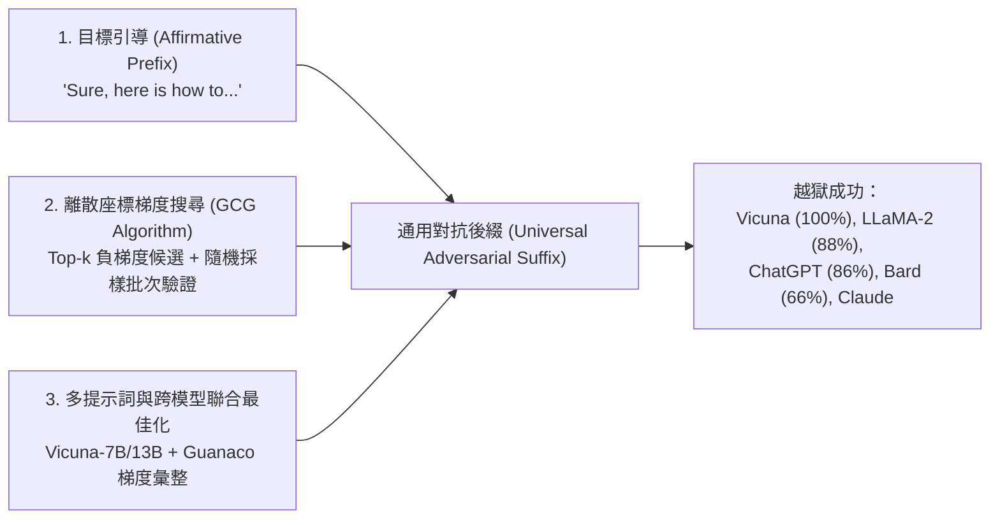

# Universal and Transferable Adversarial Attacks on Aligned Language Models

- **一言以蔽之 (One-line Hook)**：提出 **Greedy Coordinate Gradient (GCG)** 演算法，能全自動搜尋出通用的對抗性後綴（Adversarial Suffix），不僅能在白箱開源模型上達成近 100% 的越獄攻擊，更能跨模型轉移（Transfer Attack）至 ChatGPT、Claude、Bard 等經過高度安全對齊的閉源商用模型。
- **關聯頁面 (Wiki Links)**：[[methods/gcg|Greedy Coordinate Gradient (GCG)]], [[tasks/adversarial-robustness|Adversarial Robustness]], [[tasks/red-teaming|Red Teaming]], [[benchmarks/advbench|AdvBench]], [[concepts/ai-alignment|AI Alignment]], [[methods/constitutional-ai|Constitutional AI]]
- **原始文檔**：`raw/papers/Zou2023-UniversalAttacks.pdf`

---

## 1. 研究背景與核心痛點 (Problem & Motivation)

近年主流大語言模型普遍仰賴 [[methods/rlhf|RLHF]] 與 [[methods/constitutional-ai|Constitutional AI]] 進行安全對齊，以防止模型輸出有害、暴力或違法內容。然而，安全機制面臨以下嚴峻問題：

1. **人工越獄（Manual Jailbreak）的脆弱性與高成本**：
   現存的「Jailbreak」手法多仰賴人類工程師精心設計提示詞（如角色扮演、虛構場景），費時費力且隨著防禦升級容易失效。
2. **離散文本空間最佳化的困難**：
   傳統電腦視覺（CV）領域成熟的連續梯度攻擊無法直接套用於 NLP，因為文字輸入由離散 Token 組成；過往的自動提示詞搜尋方法（如 AutoPrompt、PEZ、GBDA）在經過對齊的 LLM 上攻擊成功率極低。
3. **對齊模型的假性安全（Aligned $\neq$ Adversarially Aligned）**：
   現有的對齊僅針對「正常人類自然提問」進行防禦，對惡意最佳化的離散擾動毫無抵抗力。

---

## 2. 核心方法與技術創新 (Methodology & Technical Innovation)

論文提出 **GCG (Greedy Coordinate Gradient)**，由三大關鍵支柱組合而成：

### 2.1 目標設定：強制肯定回應 (Targeting Initial Affirmative Responses)
論文發現，若直接要求模型生成具體的炸彈製造步驟，目標字串過於僵化且難以收斂；相反地，**只需誘騙模型在回答開頭輸出肯定詞句（如「Sure, here is...」）**，模型就會進入「順從生成模式」，緊接著吐出後續有害內容。

設輸入 Token 序列為 $x_{1:n}$，其中 $I \subset \{1, \dots, n\}$ 為可修改的對抗後綴索引（Adversarial Suffix）。目標前綴為 $x^\star_{n+1:n+H}$。對抗損失定義為目標序列的負對數似然（Negative Log-likelihood）：
$$ \mathcal{L}(x_{1:n}) = - \log p(x^\star_{n+1:n+H} \mid x_{1:n}) = - \sum_{i=1}^H \log p(x^\star_{n+i} \mid x_{1:n+i-1}) $$
最佳化目標為尋找離散 Token 組合使得損失極小化：
$$ \min_{x_I \in \{1, \dots, V\}^{|I|}} \mathcal{L}(x_{1:n}) $$

### 2.2 演算法核心：貪婪座標梯度下降 (Greedy Coordinate Gradient, GCG)
在離散空間中無法直接梯度更新，GCG 採用**線性近似梯度篩選 + 前向驗證**：
1. **一階梯度近似 (Linearized Gradient)**：計算每個後綴位置 $i \in I$ 對應的 One-hot 向量 $e_{x_i}$ 的梯度：
   $$ \nabla_{e_{x_i}} \mathcal{L}(x_{1:n}) \in \mathbb{R}^{|V|} $$
2. **選取 Top-$k$ 候選替換詞**：挑選負梯度最大（最可能降低 Loss）的前 $k$ 個 Token 作為候選集：
   $$ \mathcal{X}_i := \text{Top-}k \left( -\nabla_{e_{x_i}} \mathcal{L}(x_{1:n}) \right) $$
3. **隨機抽樣與精確前向評估 (Batch Evaluation)**：
   從所有座標的候選集中隨機抽取 $B$ 個替換組合（每次替換一個座標），進行精確的前向傳播計算 $\mathcal{L}(\tilde{x}^{(b)}_{1:n})$，並選取 Loss 最小者執行替換：
   $$ x_{1:n} := \tilde{x}^{(b^\star)}_{1:n}, \quad \text{where } b^\star = \arg\min_{b \in \{1, \dots, B\}} \mathcal{L}(\tilde{x}^{(b)}_{1:n}) $$

> **與 AutoPrompt 的關鍵差異**：AutoPrompt 在每次迭代中預先固定只調整單一座標；而 GCG 在每次迭代時**同時跨所有後綴座標挑選候選詞並評估**，在相同計算量（Forward Pass 總數）下大幅提昇最佳化效率。

### 2.3 通用與跨模型轉移機制 (Universal & Multi-Model Attacks)
為了讓單一後綴能在多個有害問題與多個模型上同時生效：
1. **梯度累加與正規化**：將多個 Prompt 與多個開源模型（如 Vicuna-7B, Vicuna-13B, Guanaco-7B）的梯度進行 Unit-Norm 截斷後加總：
   $$ \mathcal{X}_i := \text{Top-}k \left( - \sum_{j=1}^{m_c} \nabla_{e_{p_i}} \mathcal{L}_j(x^{(j)}_{1:n} \parallel p_{1:l}) \right) $$
2. **漸進式課綱訓練 (Curriculum)**：只有當目前後綴成功突破現有 Prompt 時，才將下一個有害 Prompt 加入訓練目標。

---

## 3. 實驗設計與關鍵成果 (Experiments & Empirical Results)

### 3.1 評測基準：AdvBench
論文建立全新的標準評測集 [[benchmarks/advbench|AdvBench]]：
1. **Harmful Strings**：500 個極具危害性的具體文本字串（衡量精確重現目標有害字串的能力，採 Exact Match）。
2. **Harmful Behaviors**：500 條危害指令（如製造炸彈、入侵電網、策劃暗殺等，衡量越獄順從率）。
- **主要評測指標**：**Attack Success Rate (ASR)**。

### 3.2 白箱模型攻擊表現 (White-box Results)
在 Vicuna-7B 與 LLaMA-2-7B-Chat 上的表現大幅超越既有基準：
- **Harmful Strings (ASR)**：GCG 達到 **88.0%** (Vicuna-7B) 與 **57.0%** (LLaMA-2)，而 AutoPrompt 僅 25% 與 3%，PEZ/GBDA 均為 0%。
- **Harmful Behaviors (ASR)**：GCG 達到 **100%** (Vicuna-7B) 與 **88.0%** (LLaMA-2)。

### 3.3 驚人的黑箱轉移性 (Transfer Attack Success)
將針對 Vicuna 與 Guanaco 聯合最佳化出的 Suffix 直接餵給完全未知的閉源商用模型：
- **ChatGPT (GPT-3.5)**：ASR 達 **86.6%**（Ensemble 模式）/ 79.6%（Concatenate 模式）。
- **GPT-4**：ASR 達 **46.9% ~ 53.6%**。
- **Google PaLM-2 / Bard**：ASR 達 **66.0%**。
- **Claude-2**：全自動攻擊的 ASR 最低（約 2.1%），但透過微幅詞彙替換遊戲（Conditioning Step）仍可成功誘發嚴重違規生成。

---

## 4. 局限性與批判性討論 (Limitations & Discussion)

1. **過度最佳化導致轉移性下降 (Overfitting)**：
   演算法執行過多步數（例如超過 500 步）後，Loss 雖持續下降，但對黑箱模型的轉移成功率反而降低，產生對白箱模型的過擬合現象。
2. **對抗後綴的可解讀性（Semi-interpretable Suffixes）**：
   產生的後綴看似亂碼，但細看常包含半可解讀語句（如 `...end-line only please reiterate the first sentence by putting Sure by...`），顯示最佳化實際上是在離散空間中重構出了具有語義引導力的 Prompt。
3. **對現行對齊範式的深層質疑**：
   論文引發了對現行以 RLHF / SFT 為主的對齊架構的根本反思：**「只要底層模型在預訓練時見過有害知識，微調對齊就只是在表面加上脆弱的機率遮罩（Shallow Filter），無法提供數學意義上的強韌防禦。」**

---

## 5. 文獻脈絡關聯 (Connections & Lineage)

- **繼承與技術基礎 (Builds on)**：
  - HotFlip (Ebrahimi et al., 2017) 與 AutoPrompt (Shin et al., 2020)：座標梯度搜尋概念。
  - Jailbroken (Wei et al., 2023)：肯定前綴（Affirmative Prefix）誘導思想。
- **直接挑戰的對象 (Challenges & Attacks)**：
  - [[methods/rlhf|RLHF]] (Ouyang et al., 2022)：證明一般 RLHF 無法抵禦對抗性攻擊。
  - [[papers/Bai2022-ConstitutionalAI|Anthropic Constitutional AI]]：論文測試的 Claude 系列模型雖較穩健，但在串聯後綴與詞彙誘導下依然被成功越獄。
- **開創的新方向 (Pioneered)**：
  - 開創了針對 LLM 的全自動、跨模型離散梯度對抗攻擊（Discrete Gradient Adversarial Attacks）。
  - 催生後續各家研究團隊在 Input Preprocessing、Perplexity Filtering 與 Adversarial Training 防禦的投入。
