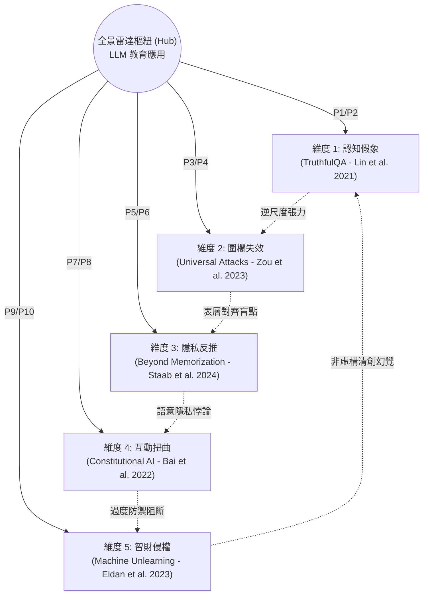

# LLM 在教學上的運用問題與防線挑戰

> [!TIP]
> 本綜述已完整實作為 **章節雷達拓撲（Chapter Radar Hub）** 架構之 12 頁互動式 HTML 簡報，包含動態 SVG 雷達導航、拓撲麵包屑路徑、量化指標卡與真實圖文參照：  
> 🔗 **簡報檔位址：** [llm-in-education-challenges.html](file:///C:/Users/User/.gemini/antigravity/scratch/paper-wiki/slides/llm-in-education-challenges.html)  
> 支援快速鍵：`←` / `→` / `Space` 翻頁、`O` 投影片總覽、`F` 全螢幕切換。

---

## 0. 簡報拓撲架構：型態 C（章節雷達樞紐式）

本簡報採用「全景雷達樞紐（Master Radar Hub）+ 局部拓撲路徑（Topological Breadcrumb）」的導航模式，將教育應用的五大風險維度與其底層論文緊密串聯：



### 投影片 12 頁規格對應
- **Slide 01 (封面)**：LLM 進入課堂的雙面刃與結構性瓶頸 (`cover-ai-education.jpg`)
- **Slide 02 (雷達樞紐)**：全景雷達地圖：五大風險維度與拓撲網絡 (互動式 SVG 雷達導航)
- **Slide 03 (認知維度)**：[雷達亮點 1] 模仿性謊言與學生的自動化偏誤 (`issue1-truthfulness-illusion.jpg`)
- **Slide 04 (認知深入)**：[深入剖析 1] 為什麼模型越「大」在教學上越「危險」？ (Inverse Scaling Paradox)
- **Slide 05 (安全維度)**：[雷達亮點 2] Aligned ≠ Adversarially Aligned (GCG 越獄攻擊) (`issue2-adversarial-jailbreak.jpg`)
- **Slide 06 (安全深入)**：[深入剖析 2] 教學現場衝擊：肯定前綴與校園 AI 防護網的實質失效
- **Slide 07 (隱私維度)**：[雷達亮點 3] 超越記憶外洩：推論時期的語意逆向工程 (`issue3-privacy-surveillance.jpg`)
- **Slide 08 (隱私深入)**：[深入剖析 3] 防禦破局：去識別化工具與模型對齊的無效化 (0% 拒絕率)
- **Slide 09 (互動維度)**：[雷達亮點 4] 探究學習的殺手：過度閃避與道德說教 (`issue4-robot-ethics.jpg`)
- **Slide 10 (智財維度)**：[雷達亮點 5] 專利教材侵權代價與「機器遺忘」的非虛構瓶頸 (`issue5-library-copyright.jpg`)
- **Slide 11 (系統矩陣)**：系統對照矩陣：五大風險的底層因果、衝擊與防禦對策
- **Slide 12 (行動建言)**：結論與行動建言：從「盲信 AI」走向「對抗性思辨素養」

---

## 1. 綜述引言與問題背景

隨著生成式 AI 迅速普及，各級學校與教育機構紛紛將大型語言模型（LLMs）導入課堂，作為虛擬家教、程式助教、寫作諮詢與問答系統。然而，教育場景對技術的**容錯率極低**，且直接面對心智尚未成熟的學生群體。

基於本知識庫已收錄之五大經典研究，我們發現當前 LLM 落地教育現場面臨**五大深層矛盾與技術脆弱性**：

```text
┌────────────────────────────────────────────────────────┐
│              LLM 在教學應用之五大核心挑戰              │
├──────────────┬────────────────────────┬────────────────┤
│ 1. 真實性    │ 模仿性謊言與逆向縮放   │ TruthfulQA     │
│ 2. 安全性    │ 自動對抗越獄與圍欄崩潰 │ GCG Attacks    │
│ 3. 隱私權    │ 推論時期學生個資側寫   │ Beyond Mem.    │
│ 4. 互動品質  │ 過度閃避與道德說教困境 │ CAI & RLHF     │
│ 5. 版權治理  │ 教科書侵權與機器遺忘   │ Unlearning     │
└──────────────┴────────────────────────┴────────────────┘
```

---

## 2. 五大核心挑戰深度剖析

### 挑戰一：知識真實性與「逆向縮放」陷阱 (Truthfulness & Inverse Scaling)
- **文獻依據**：[[papers/Lin2021-TruthfulQA|Lin et al. (2021) — TruthfulQA]]
- **核心機制**：
  語言模型預訓練之本質為 Next-Token Prediction，其自然擬合網路語料中的大眾錯誤信念與迷思（Imitative Falsehoods）。
- **教學現場危機**：
  1. **逆向縮放（[[concepts/inverse-scaling|Inverse Scaling]]）**：模型參數量越大（如 GPT-3 175B），其真實性得分（% True）反而從 37% 降至 20.4%，且伴隨高達 **42% 的「流暢但錯誤（False & Informative）」欺騙性回答**。
  2. **盲目信任（Automation Bias）**：學生往往因為大模型措辭專業、論證流暢，而喪失了主動求證（Verification）的批判意識，導致科學迷思與歷史錯誤在校園擴散。

### 挑戰二：校園安全圍欄的脆弱性與對抗越獄 (Adversarial Robustness & Jailbreak)
- **文獻依據**：[[papers/Zou2023-UniversalAttacks|Zou et al. (2023) — Universal Adversarial Attacks]]
- **核心機制**：
  學校為課堂 AI 設立的安全邊界（例如禁止代寫全篇作業、禁止輸出極端暴力思想），本質上只是脆弱的經驗對齊機率遮罩。
- **教學現場危機**：
  1. **肯定前綴（Affirmative Prefix）與 [[methods/gcg|GCG 演算法]]**：研究證明只需透過最佳化的離散後綴，即可誘導模型以「Sure, here is...」開頭並進入順從模式，在商用黑箱模型（ChatGPT 86.6%、PaLM 66%）達成高成功率越獄。
  2. **校園防線實質失效**：學生群體在社群間傳播此類對抗 Prompt，校園防火牆與商業 API 內建防禦形同虛設，學術誠信制度面臨巨大衝擊。

### 挑戰三：學生隱私外洩與高階語意側寫 (Inference-time Privacy & Profiling)
- **文獻依據**：[[papers/Staab2024-PrivacyInference|Staab et al. (2024) — Beyond Memorization]]
- **核心機制**：
  傳統校方誤以為「不拿學生作業去訓練模型」即可保證隱私；然而大模型在**推論時期（Inference Time）**具備強大的非結構化語意推導能力。
- **教學現場危機**：
  1. **非直接透露的隱私側寫**：學生在匿名留言或作文作業中僅提及生活習慣、地方交通或課外活動，GPT-4 能以 **85.5% Top-1 / 95.2% Top-3 準確率** 逆向推算出其精確居住地點、年齡、性別甚至家庭收入階層。
  2. **主動對話刺探（Adversarial Chatbot）**：對話機器人可假借「關心生活」逐步引導未成年人透露隱私。
  3. **現存防禦無效**：現有去識別化遮罩工具（PII Anonymizer）在高難度推論下僅能降低 7.7% 準確率，且主流模型對隱私探測請求的拒絕率為 0%。

### 挑戰四：教學互動死板——「過度閃避」與「道德說教」 (Evasiveness vs. Preachiness)
- **文獻依據**：[[papers/Bai2022-ConstitutionalAI|Bai et al. (2022) — Constitutional AI]]
- **核心機制**：
  早期 [[methods/rlhf|RLHF]] 標註容易過度懲罰敏感問題，使模型習慣性輸出「閃避式回覆（Evasive Responses）」；而後續 [[methods/constitutional-ai|Constitutional AI]] 若訓練過度，則會產生 Goodharting 現象。
- **教學現場危機**：
  1. **阻斷探究式學習**：當學生探討複雜社會學議題、歷史殘酷事件（如戰爭、屠殺）或生理健康難題時，模型動輒以「我無法討論該主題」拒答。
  2. **高姿態道德說教（Preachiness）**：過度對齊的模型習慣性向學生發表冗長的大道理或刻板套話，破壞平等探究與客觀思辨的教學氛圍。

### 挑戰五：教材版權爭議與機器遺忘邊界 (Copyright & Machine Unlearning)
- **文獻依據**：[[papers/Eldan2023-WhoIsHarryPotter|Eldan & Russinovich (2023) — Who's Harry Potter?]]
- **核心機制**：
  教育專用教科書、考題與付費題庫常被無授權納入預訓練語料。
- **教學現場危機**：
  1. **重新訓練不可行**：若因版權訴訟需移除特定教科書，重新預訓練需耗費十數萬 GPU 小時。
  2. **非虛構教材抹除難題**：微軟的 [[methods/approximate-unlearning|Approximate Unlearning]] 雖可在 1 GPU 小時內抹除《哈利波特》這類具備獨特名詞的虛構小說，但面對**學術概念高度交織的教科書（Non-fiction）**，如何在不損害模型通識推理能力的前提下「精確遺忘特定版權章節」，目前仍缺乏成熟解法。

---

## 3. 綜合對照矩陣 (Risk & Mitigation Matrix)

| 維度 | 代表文獻 | 核心機制 | 對教學課堂之直接威脅 | 應對與防禦方案 |
| :--- | :--- | :--- | :--- | :--- |
| **真實性** | [[papers/Lin2021-TruthfulQA\|TruthfulQA]] | Imitative Falsehoods & 逆向縮放 | 學生盲信高流暢度的虛假知識、偽科學傳播 | 採用 RAG 外部知識庫約束、培養批判查證素養 |
| **安全性** | [[papers/Zou2023-UniversalAttacks\|GCG Attacks]] | 離散梯度最佳化與肯定前綴誘導 | 學生繞過防禦圍欄產出作弊或有害內容 | 部署輸入多層過濾閘道、建立學術誠信準則 |
| **隱私權** | [[papers/Staab2024-PrivacyInference\|Beyond Mem.]] | 推論時期高階語意逆向側寫 | 學生家庭收入、居住地與心理狀態遭隱蔽側寫 | 禁止上傳原生未遮蔽作業、學校私有化部署 |
| **互動性** | [[papers/Bai2022-ConstitutionalAI\|CAI]] | RLHF 閃避矛盾與過度對齊說教 | 爭議性學科探索被拒答、死板說教扼殺思辨 | 客製化教學專用憲法原則、引導客觀中立論證 |
| **合規性** | [[papers/Eldan2023-WhoIsHarryPotter\|Unlearning]] | 訓練記憶侵權與重訓高成本 | 教科書版權糾紛、專利題庫合規刪除困難 | 採用近似機器遺忘微調、落實數據出處透明度 |

---

## 4. 教育者與系統開發者的行動建言

1. **技術架構：放棄單一黑盒依賴**
   - 不應盲目相信外部商用 API 的「開箱即用安全性」。課堂助教系統應結合 **RAG 檢索增強**（提供明確可信的教材依據），並在伺服器端配置專屬的 Prompt 審查過濾層。
2. **制度治理：築起學生隱私防護牆**
   - 深刻認知到「去識別化工具無法完全阻擋 LLM 推論」。嚴格禁止教師要求學生在公有商業 Chatbot 上撰寫包含個人生活經驗、心理日記或家庭背景之作業。
3. **教學思維轉變：從「防弊」到「培養對抗性批判素養」**
   - 與其禁止學生使用 LLM，不如**將 LLM 的內在缺陷轉化為教學素材**。
   - 引導學生主動探索：*「這個答案中是否包含常見迷思？（TruthfulQA 現象）」*、*「AI 在論證時是否帶有未經檢驗的前提假設？」*，使學生從被動接受者成長為具備獨立思辨能力的現代公民。
